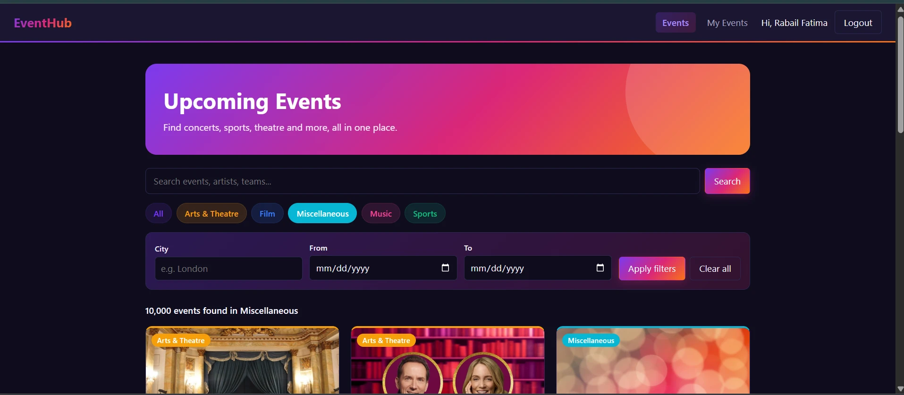
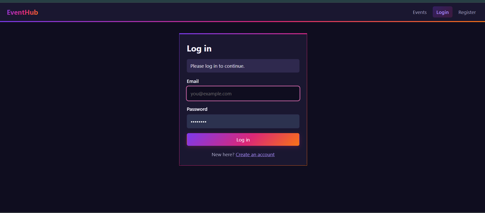
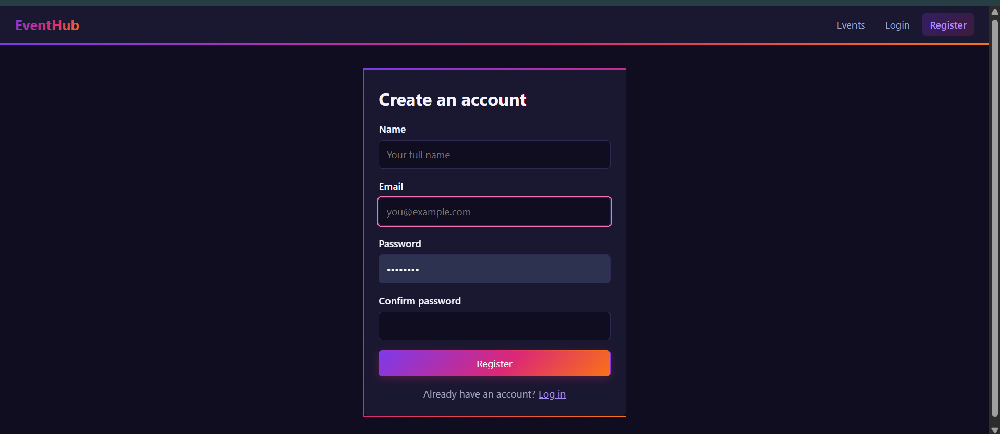
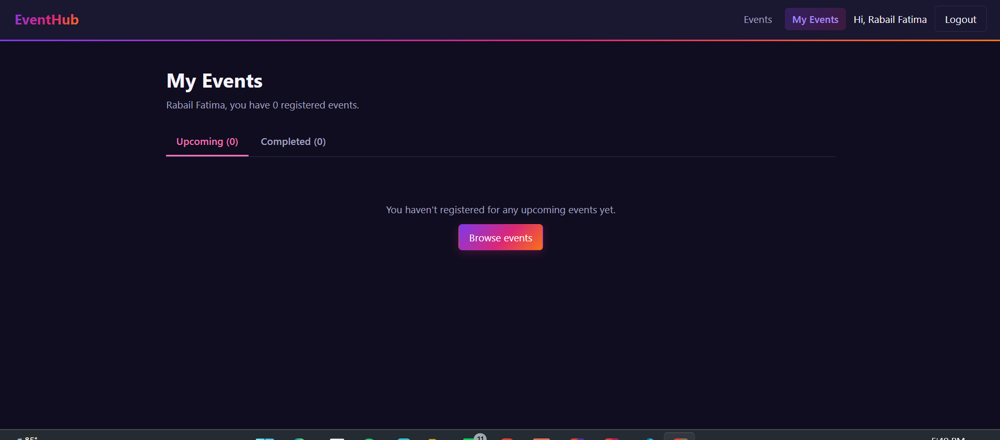
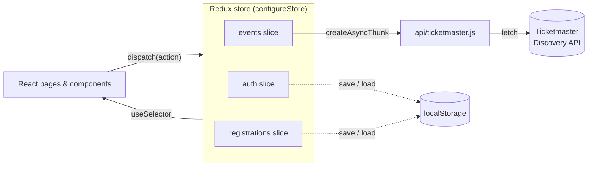

<div align="center">

# 🎟️ EventHub

### Discover, search and register for real events, all in one place.

An Event Management System built with **React**, **Redux Toolkit** and **React Router**, powered by live data from the **Ticketmaster Discovery API**.


*Web Programming – Assignment 2*

</div>

---

## 📸 Screenshots

<p align="center">
  
  <br />
  <b>Browse & filter events</b><br />
  <sub>Gradient hero banner, colour-coded category chips, keyword search, city and date filters</sub>
</p>

<table>
  <tr>
    <td align="center" width="33%">
      
      <br />
      <b>Log in</b><br />
      <sub>Redirects you back after login</sub>
    </td>
    <td align="center" width="33%">
      
      <br />
      <b>Create an account</b><br />
      <sub>Validated form, saved with Redux</sub>
    </td>
    <td align="center" width="33%">
      
      <br />
      <b>My Events</b><br />
      <sub>Upcoming and Completed tabs</sub>
    </td>
  </tr>
</table>

---

## ✨ Features

<table>
  <tr>
    <td width="50%" valign="top">

#### 🔐 Authentication
- Register with name, email and password
- Login / logout with clear error messages
- Stays logged in after a page refresh (localStorage)
- Protected **My Events** page that returns you to where you were after login

#### 🔎 Event Exploration
- Live upcoming events from Ticketmaster
- **Debounced** keyword search (waits for you to stop typing)
- Category chips loaded from the API
- City and **From / To** date filters
- Pagination, plus filters that are kept when you go back

    </td>
    <td width="50%" valign="top">

#### 📄 Event Details
- Large image, category, genre and sale status
- Date & time, venue, full address, time zone
- Price range, event info, important notes
- Venue **seat map** and a link to buy on Ticketmaster

#### 🗓️ Registration & My Events
- Register for an event in one click, with a confirmation message
- **Duplicate registrations blocked**
- Cancel with an "Are you sure?" step
- **Upcoming** and **Completed** tabs, saved per user

    </td>
  </tr>
</table>

**Also included:** loading spinners, friendly error messages with *Try again*, form validation, 404 page, responsive layout for phones, automatic light/dark mode, and a colourful theme where every category has its own colour.

---

## 🧭 How it works



| Slice | Holds | Actions |
|---|---|---|
| `auth` | `users`, `currentUser`, `error` | `registerUser`, `loginUser`, `logout`, `clearAuthError` |
| `events` | `items`, `status`, `error`, `page`, `filters`, `currentPage`, `categories`, `selectedEvent` | `setFilters`, `clearFilters`, `setPage` · thunks `fetchEvents`, `fetchCategories`, `fetchEventById` |
| `registrations` | `byUser` (user id → their events) | `registerForEvent`, `cancelRegistration` |

---

## 🚀 Getting Started

### Prerequisites
- [Node.js](https://nodejs.org/) 18 or newer
- A free Ticketmaster API key

### 1. Get your API key
1. Sign up at **<https://developer.ticketmaster.com/>**
2. Open **My Apps** and copy the **Consumer Key**. That is your API key.

### 2. Install

```bash
git clone https://github.com/Rabailfatima13/Web_assignment2.git
cd Web_assignment2
npm install
```

### 3. Add your key
Copy `.env.example` to a new file named `.env` in the project root:

```
VITE_TM_API_KEY=your_consumer_key_here
```

> 🔒 `.env` is in `.gitignore`, so your key is never pushed to GitHub. Restart the dev server after changing it.

### 4. Run

```bash
npm run dev
```

Then open **<http://localhost:5173>**.

### Scripts

| Command | Description |
|---|---|
| `npm run dev` | Start the development server |
| `npm run build` | Create a production build in `dist/` |
| `npm run preview` | Preview the production build |
| `npm run lint` | Check code with ESLint |

---

## 🗺️ Routes

| Path | Page | Login required |
|---|---|:---:|
| `/` | Events: search, filters, list | — |
| `/events/:id` | Event details & registration | Only to register |
| `/login` | Login | — |
| `/register` | Create account | — |
| `/my-events` | My Events: Upcoming / Completed | ✅ |
| `*` | 404 Not Found | — |

---

## 📁 Project Structure

```
src/
├── api/
│   └── ticketmaster.js          # All API requests + simplifying event data
├── app/
│   └── store.js                 # configureStore + localStorage saving
├── features/
│   ├── auth/authSlice.js
│   ├── events/eventsSlice.js
│   └── registrations/registrationsSlice.js
├── components/                  # Reusable UI
│   ├── Navbar · EventCard · SearchBar · Filters · CategoryChips
│   ├── Pagination · Loader · ErrorMessage · Toast
│   └── FormInput · ProtectedRoute · RegistrationButton · CancelButton
├── pages/                       # One file per route
│   └── Events · EventDetails · Login · Register · MyEvents · NotFound
├── utils/formatDate.js          # Date formatting + isEventPast()
├── App.jsx                      # Route definitions
└── main.jsx                     # <Provider> + <BrowserRouter>
```

---

## 📝 Notes & Limitations

- **Frontend-only authentication**, as the assignment allows. Passwords are stored in plain text in localStorage; a real app would check passwords on a server and store them hashed.
- The API key is kept out of the repository with a Vite environment variable, but it is still visible in the browser while the app runs, which is normal for frontend-only apps.
- Ticketmaster limits: about **2 requests/second** and **5,000/day**, and only the first **1,000 results** of a search can be paged through.
- Ticketmaster compares the **To** date in UTC, so a few results may fall on the following day.

<div align="center">

---

Made with ❤️ using React & Redux Toolkit

</div>
